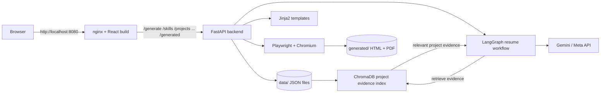

<div align="center">

# ResumeAI

**Generate ATS-friendly, one-page resumes tailored to any job — in seconds.**

Paste a job description (or just a job title) and ResumeAI selects your best skills and projects, rewrites them for the role, scores the match, and exports a polished HTML + PDF resume.


</div>

---

## Table of Contents
- [Features](#features)
- [Architecture](#architecture)
- [Tech Stack](#tech-stack)
- [Quick Start (Docker)](#quick-start-docker)
- [Configuration](#configuration)
- [Local Development (without Docker)](#local-development-without-docker)
- [Using the App](#using-the-app)
- [API Overview](#api-overview)
- [Project Structure](#project-structure)
- [Data & Persistence](#data--persistence)
- [Common Commands](#common-commands)
- [Troubleshooting](#troubleshooting)
- [Security Notes](#security-notes)
- [Contributing](#contributing)
- [License](#license)

---

## Features

- **Two ways to generate** – paste a full job description, or enter only a job title and experience level (Fresher / Junior) and let the AI build the job profile.
- **Agentic self-reflection & RAG** – a LangGraph workflow retrieves relevant saved project evidence through ChromaDB and retries weak drafts; deterministic keyword guardrails reject banned buzzwords and job technologies unsupported by project records.
- **Smart tailoring** – picks the most relevant skills and ranks your projects against the job, then rewrites summary and project bullets for the role.
- **ATS scoring** – overall ATS score with skill and project sub-scores, skill match, and skill-gap recommendations.
- **Recruiter check & validation** – flags weak or missing content before you send the resume.
- **Keyword highlighting** – optionally bolds job keywords that actually appear in your resume.
- **One-page guarantee** – content is auto-fitted to a single page; you get a clear error if it can't fit.
- **Photo and no-photo versions** – generates both `resume.pdf` and `resume_photo.pdf`.
- **Multiple AI providers** – Gemini or Meta, selectable per request, with optional fallback and per-node latency telemetry in the backend pipeline.
- **Profile manager UI** – dashboard with modules for Personal, Contact, Summary, Skills, Experience, Education, Projects, Certifications and Achievements.
- **One-command deployment** – fully containerised with Docker Compose.

## Architecture



The frontend container serves the UI and reverse-proxies API calls to the backend, so there is **no CORS or URL configuration** to manage.

## Tech Stack

| Layer | Technology |
|---|---|
| Frontend | React 19, TypeScript, Vite, Tailwind CSS 4, React Router, Axios |
| Backend | FastAPI, Pydantic, Uvicorn, Jinja2, BeautifulSoup |
| AI | Google Gemini (`google-genai`), Meta API, LangGraph, ChromaDB |
| PDF | Playwright + Chromium |
| Deployment | Docker, Docker Compose, nginx |

## Quick Start (Docker)

### Prerequisites
- [Docker](https://docs.docker.com/get-docker/) with the Compose plugin (`docker compose version`)
- A free [Gemini API key](https://aistudio.google.com/apikey)
- About 3 GB of free disk and 2 GB+ RAM for Docker

### Steps
```bash
# 1. Clone
git clone https://github.com/mohit7705/ResumeAI-ATS-Resume-Builder.git ResumeAI
cd ResumeAI

# 2. Configure
cp .env.example .env
#    open .env and set GOOGLE_API_KEY

# 3. Add one profile photo (.jpg or .png)
mkdir -p assets && cp /path/to/photo.jpg assets/

# 4. Build and run
docker compose up --build
```

Open **http://localhost:8080**. The first build takes a few minutes (Python packages and Chromium); later starts are fast.

Run in the background with `docker compose up -d --build`.

## Configuration

All settings live in `.env` (copy from `.env.example`).

| Variable | Required | Description | Example |
|---|---|---|---|
| `GOOGLE_API_KEY` | Yes (for Gemini) | Gemini API key | `AIza...` |
| `GOOGLE_MODEL` | Yes (for Gemini) | Gemini model name | `gemini-2.5-flash` |
| `LLM_PROVIDER` | No | Default provider: `gemini` or `meta` | `gemini` |
| `LLM_FALLBACK` | No | Provider to use if the main one fails | `meta` |
| `META_API_KEY` | No | Meta API key | |
| `META_MODEL` | No | Meta model name | `muse-spark-1.1` |
| `META_API_BASE` | No | Meta API base URL | `https://api.meta.ai/v1` |
| `APP_PORT` | No | Host port for the app (default `8080`) | `9000` |

After changing `.env`: `docker compose up -d --force-recreate backend`.

## Local Development (without Docker)

**Backend** (run from the project root):
```bash
python -m venv .venv && source .venv/bin/activate
pip install -r requirements.txt pytest
playwright install chromium
cp .env.example .env            # add your API key
uvicorn backend.main:app --reload --port 8000
```

**Frontend:**
```bash
cd frontend
npm install
npm run dev                     # http://localhost:5173
```

> The frontend calls the API on the same origin. For local development, add a Vite proxy for the backend routes in `frontend/vite.config.ts`, or run the full stack with Docker.

## Using the App

1. **Fill your profile** – complete Personal, Contact, Summary, Skills, Experience, Education, Projects, Certifications and Achievements. The dashboard shows your completion progress.
2. **Open the Resume page** and choose a mode:
   - *Job description* – paste the posting.
   - *Job title* – enter a title and level.
3. Choose the AI provider, keyword highlighting, and whether to include the photo version.
4. **Generate** – review the ATS score, skill match, gap recommendations, recruiter check and top projects.
5. **Preview and download** the HTML or PDF.

## API Overview

Interactive docs are available at **http://localhost:8080/docs** when the app is running.

| Method | Endpoint | Purpose |
|---|---|---|
| `POST` | `/generate` | Generate a resume from a job description |
| `POST` | `/generate/title` | Generate a resume from a job title and level |
| `GET` | `/ai/providers` | Available AI providers and models |
| `GET/PUT` | `/personal`, `/contact`, `/summary`, `/skills` | Profile data |
| `GET/POST…` | `/experience`, `/education`, `/projects`, `/certifications`, `/achievements` | List-based profile sections |
| `GET` | `/generated/...` | Generated HTML and PDF files |

## Project Structure

```
ResumeAI/
├── backend/                 # FastAPI application
│   ├── main.py              # App entry point and resume pipeline
│   ├── ai/                  # LangGraph workflow, ChromaDB RAG, LLM clients, matching and guardrails
│   ├── api/                 # CRUD routers for profile data
│   ├── resume/              # Engine, builder, validator, highlighter, recruiter check
│   ├── generator/           # HTML (Jinja2) and PDF (Playwright) generation
│   ├── models/  utils/  core/  data/
├── frontend/                # React + Vite app
│   ├── src/
│   │   ├── modules/         # Feature screens (resume, skills, projects, ...)
│   │   ├── components/      # Layout and UI components
│   │   ├── services/        # API clients
│   │   └── context/         # App, theme and toast state
│   ├── Dockerfile
│   └── nginx.conf
├── templates/               # Resume HTML + CSS templates
├── data/                    # Your resume data (JSON, git-ignored)
├── assets/                  # Profile photo (git-ignored)
├── generated/               # Output HTML/PDF (git-ignored)
├── tests/
├── Dockerfile               # Backend image
├── docker-compose.yml
├── docker-entrypoint.sh     # Seeds empty data files on first run
├── requirements.txt
└── .env.example
```

## Data & Persistence

- `./data` and `./assets` are **bind-mounted** into the backend container, so your data survives rebuilds and can be edited on disk.
- Empty data files are created automatically on first run.
- Generated resumes are stored in the `generated` Docker volume.

## Common Commands

```bash
docker compose up -d --build      # start in background
docker compose ps                 # status
docker compose logs -f backend    # backend logs
docker compose restart backend    # restart backend
docker compose down               # stop (data is kept)
docker compose down -v            # stop and remove generated files
```

## Troubleshooting

| Problem | Solution |
|---|---|
| `env file .env not found` | Run `cp .env.example .env`. |
| `GOOGLE_API_KEY not found` | Set the key in `.env`, then recreate the backend container. |
| UI loads but requests fail | Make sure `frontend/src` has no `127.0.0.1:8000` left, then rebuild the frontend. |
| `No photo found` / `Found N photos` | Keep exactly one `.jpg` or `.png` in `assets/`. |
| `Resume is still more than 1 page` | Shorten the summary, project bullets or experience text. |
| PDF generation crashes | Increase Docker memory (Docker Desktop → Settings → Resources). |
| Port already in use | Set `APP_PORT` in `.env` to a free port. |
| Slow first request | AI + PDF generation can take up to a minute; nginx allows up to 5 minutes. |

## Security Notes

- Never commit `.env`; only `.env.example` belongs in the repository.
- `data/` may contain personal information – keep it git-ignored in public repositories.
- Rotate your API key immediately if it is ever exposed.

## Contributing

1. Fork the repository and create a feature branch: `git checkout -b feature/my-change`
2. Make your changes and run the tests: `pytest tests/`
3. Commit with a clear message and open a pull request.

## License

Add your license here (for example MIT) and include a `LICENSE` file in the repository root.
